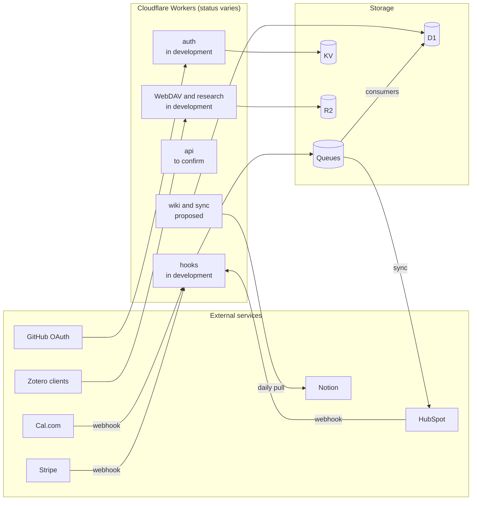

The ecosystem exposes a small number of services, each with a single job. They run as Cloudflare Workers, share common conventions, and connect to a handful of third-party platforms. This page lists them, explains the separation between public and commercial systems, and records the conventions to follow.

:::info[Status: Draft]
Everything here is owner-stated. None of it has been checked against deployed configuration. The existing [API overview](../api/overview.md) is still a template.
:::

## Service inventory

| Service | Hostname | Purpose | Visibility | Status |
| --- | --- | --- | --- | --- |
| `rjmlaird-api` | `api` | Public portfolio and content data | Public | Proposed (deployment to confirm) |
| `rjmlaird-services` | `hooks` | Verified webhook ingress; payment, booking and CRM workflows | Machine-facing; private repository | In development |
| `rjmlaird-auth` | `auth` | GitHub sign-in with a user allow-list | Browser-facing | In development |
| Wiki | `wiki` | Private, read-only Notion-backed wiki | Private | Proposed |
| Zotero WebDAV | Mount point to confirm | File sync for Zotero, plus a research ingest route | Authenticated clients | In development |

### Why public and commercial services are separate

The public portfolio API and the commercial webhook service are deliberately **different systems** (see [ADR-0003](./adrs/ADR-0003-separate-public-api-from-webhook-services.md)). The commercial service exposes no public portfolio data and no customer lists. The public API has no access to payment or CRM events. Neither can leak what it does not hold.

## Conventions

| Convention | Rule | Basis |
| --- | --- | --- |
| Framework | Hono on Cloudflare Workers, written in TypeScript | Owner-stated |
| Versioning | URL prefix `/v1/` | Webhook, WebDAV and research routes already follow it |
| Validation | Zod schemas, shared through a contracts package | `rjmlaird-services` |
| Documentation | OpenAPI for any API with external consumers | Zotero WebDAV spec exists; the docs template suggests generating from OpenAPI |
| Service-to-service calls | Cloudflare service bindings (for example the `AUTH` binding to `rjmlaird-auth`) | Owner-stated |
| Authoritative records | HubSpot stays the CRM authority; no bidirectional sync | Owner-stated |

## Known routes

| Route | Service | Notes |
| --- | --- | --- |
| `/v1/webhooks/stripe` | `hooks` | Verified payment events |
| `/v1/webhooks/calcom` | `hooks` | Verified booking events |
| `/v1/webhooks/hubspot` | `hooks` | Verified CRM events |
| `/webdav` and `/v1/webdav` | WebDAV service | OPTIONS, GET, PUT and DELETE, tagged "WebDAV" in OpenAPI |
| `/v1/research` | WebDAV service codebase | Zotero API ingest into R2 under `papers/` |

## Authentication patterns

| Surface | Mechanism | Status |
| --- | --- | --- |
| Interactive sign-in | GitHub OAuth through `auth`, with an allow-list of users | In development |
| Session | Cookie shared across `*.rjmlaird.co.uk` | In development |
| Private wiki | Cloudflare Access (initially one account) | Proposed |
| Webhook endpoints | Provider signature verification | In development |
| Public API | To confirm; at minimum rate limiting | To confirm |

See [Security, privacy and access control](./security-privacy-access.md) for the trade-offs of the shared cookie.

## Third-party integrations

| System | Role | Direction |
| --- | --- | --- |
| GitHub | OAuth identity; hosting and CI for the docs | Both |
| Stripe | Payment events | Inbound webhooks |
| Cal.com | Booking events | Inbound webhooks |
| HubSpot | CRM; authority for contact records | Inbound webhooks and outbound sync |
| Notion | Source content for the wiki | Outbound pull on a daily schedule |
| Zotero | File sync and library ingest | Inbound from clients |

## Architecture diagram

Which Worker uses which store is the intended design, not a verified deployment.

## To confirm

1. Is `api.rjmlaird.co.uk` deployed, and what does it return today?
2. Where is the WebDAV service mounted: its own hostname, or under `api`?
3. Is the OpenAPI specification published, and if so, where?
4. What authentication and rate limiting apply to the public API?
5. Which HubSpot scopes does the integration use?

## Related pages

- [Automation and workflows](./automation-workflows.md)
- [Security, privacy and access control](./security-privacy-access.md)
- [API reference](../api/overview.md)
