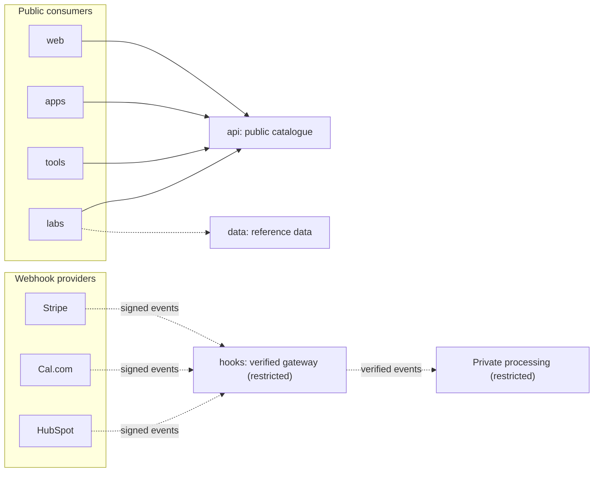

The ecosystem exposes a small number of services, each with a single job. They run as Cloudflare Workers, share common conventions, and connect to a handful of third-party platforms. This page lists them, explains the separation between public and commercial systems, and records the conventions to follow.

:::info[Status: Draft]
Everything here is owner-stated. None of it has been checked against deployed configuration. The existing [API overview](../api/overview.md) is still a template.
:::

## Public APIs and private operations

| Kind | Services | Rule |
| --- | --- | --- |
| Public, read-oriented | [api](../services/platform/api.md), [data](../services/platform/data.md) | Serve only content already approved for publication. No customer records, billing, private operations, raw uploads, access tokens or private data |
| Restricted | [hooks](../services/platform/hooks.md), [mcp](../services/platform/mcp.md), [upload](../services/platform/upload.md), [dav](../services/platform/dav.md), [dam](../services/platform/dam.md) | Denied by default; each states its access model |
| Browser-facing integration | [booking](../services/platform/booking.md) | A narrow boundary to providers; never exposes customer records |

## Service inventory

| Service | Hostname | Purpose | Visibility | Status |
| --- | --- | --- | --- | --- |
| `rjmlaird-api` | `api` | Public portfolio and content data | Public | Proposed (deployment to confirm) |
| `rjmlaird-services` | `hooks`, `booking`, `billing` | Verified webhook ingress; booking and checkout APIs; payment, booking and CRM workflows. See [Services](../services/index.md) | Machine-facing and browser-facing; private repository | In development |
| `rjmlaird-auth` | `auth` | GitHub sign-in with a user allow-list | Browser-facing | In development |
| Wiki | `wiki` | Private, read-only Notion-backed wiki | Private | Proposed |
| Zotero WebDAV | `dav` (intended; to confirm) | File sync for Zotero, plus a research ingest route | Authenticated clients | In development |

### Why public and commercial services are separate

The public portfolio API and the commercial webhook service are deliberately **different systems** (see [ADR-0003](./adrs/ADR-0003-separate-public-api-from-webhook-services.md)). The commercial service exposes no public portfolio data and no customer lists. The public API has no access to payment or CRM events. Neither can leak what it does not hold.

## Conventions

| Convention | Rule | Basis |
| --- | --- | --- |
| Framework | Hono on Cloudflare Workers, written in TypeScript | Owner-stated |
| Versioning | URL prefix `/v1/` | Webhook, WebDAV and research routes already follow it |
| Validation | Zod schemas, shared through a contracts package | `rjmlaird-services` |
| Documentation | OpenAPI for any API with external consumers | Zotero WebDAV spec exists; the docs template suggests generating from OpenAPI |
| Service-to-service calls | Cloudflare service bindings (for example the `AUTH` binding to `rjmlaird-auth`) | Owner-stated |
| Authoritative records | HubSpot stays the CRM authority; no bidirectional sync | Owner-stated |

## Known routes

| Route | Service | Notes |
| --- | --- | --- |
| `/v1/webhooks/stripe` | `hooks` | Verified payment events |
| `/v1/webhooks/calcom` | `hooks` | Verified booking events |
| `/v1/webhooks/hubspot` | `hooks` | Verified and acknowledged; enqueues nothing in the MVP |
| `/v1/services`, `/v1/booking-intents` | `booking` | See [HTTP contracts](../services/reference/http-contracts.md) |
| `/v1/checkout-sessions`, `/v1/customer-portal-sessions` | `billing` | The portal route returns `501` |
| `/webdav` and `/v1/webdav` | WebDAV service | OPTIONS, GET, PUT and DELETE, tagged "WebDAV" in OpenAPI. Intended to live on [dav](../services/platform/dav.md), not the public API |
| `/v1/research` | WebDAV service codebase | Zotero API ingest into R2 under `papers/` |

## Authentication patterns

| Surface | Mechanism | Status |
| --- | --- | --- |
| Interactive sign-in | GitHub OAuth through `auth`, with an allow-list of users | In development |
| Session | Cookie shared across `*.rjmlaird.co.uk` | In development |
| Private wiki | Cloudflare Access (initially one account) | Proposed |
| Webhook endpoints | Provider signature verification | In development |
| Public API | To confirm; at minimum rate limiting | To confirm |

See [Security, privacy and access control](./security-privacy-access.md) for the trade-offs of the shared cookie.

## Webhook boundaries

1. Provider webhooks enter only through [hooks](../services/platform/hooks.md). No other service accepts them.
2. A request is untrusted until its signature verifies over the raw body.
3. The gateway holds webhook secrets and a queue producer, never storage or provider API tokens.
4. Verified events are normalised into internal events; provider payloads are never passed on as they are.
5. A redirect or client claim is never proof of an event. Only a verified webhook is.

The contracts are in [HTTP contracts](../services/reference/http-contracts.md) and [Internal events](../services/reference/events.md).

## Contract and versioning rules

- Version the URL (`/v1/`) for HTTP APIs and the type name (`…v1`) for internal events.
- Additive, optional changes stay in the current version. A breaking change creates a new version, and the old one is removed only after every consumer has moved.
- Consumers send unknown event types to a dead-letter queue instead of dropping them.
- Money is an integer in minor units plus an ISO 4217 currency, never a float.
- Validate every external input with a schema.
- Publish OpenAPI for any API with external consumers.

## Third-party integrations

| System | Role | Direction |
| --- | --- | --- |
| GitHub | OAuth identity; hosting and CI for the docs | Both |
| Stripe | Payment events | Inbound webhooks |
| Cal.com | Booking events | Inbound webhooks |
| HubSpot | CRM; authority for contact records | Outbound contact sync; the inbound webhook route only verifies and acknowledges |
| Notion | Source content for the wiki | Outbound pull on a daily schedule |
| Zotero | File sync and library ingest | Inbound from clients |

## Architecture diagram

Solid lines show the intended read path for public content. Dotted lines show integrations that are in development or optional; none is verified as live. See the [generated catalogue](./generated/subdomain-catalogue.md) for the lifecycle of each service.

## To confirm

1. Is `api.rjmlaird.co.uk` deployed, and what does it return today?
2. Where is the WebDAV service mounted: its own hostname, or under `api`?
3. Is the OpenAPI specification published, and if so, where?
4. What authentication and rate limiting apply to the public API?

## Related pages

- [Automation and workflows](./automation-workflows.md)
- [Security, privacy and access control](./security-privacy-access.md)
- [Platform services](../services/platform/overview.md)
- [Services](../services/index.md)
- [API reference](../api/overview.md)
