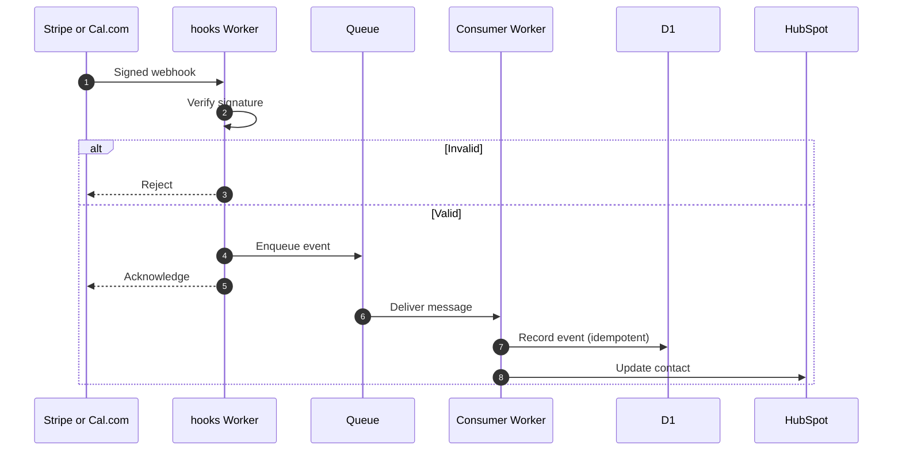

Several parts of the ecosystem run without anyone pressing a button: a documentation build on every merge, queue consumers that react to payments and bookings, and a planned daily wiki sync. This page lists them and sets out how new automation should behave.

## Workflow inventory

| Workflow | Trigger | What it does | Status |
| --- | --- | --- | --- |
| Docs build and deploy | Push to `main`; pull request build check | Typechecks, builds and deploys the docs | Live (repository) |
| Stripe event processing | Verified webhook, then queue | Records payment events | In development |
| Cal.com event processing | Verified webhook, then queue | Records booking events | In development |
| HubSpot sync | Queue consumer | Updates the CRM; HubSpot stays authoritative | In development |
| Client-delivery follow-ups | Queue consumer | Triggers follow-up steps after a booking or payment | In development |
| Wiki sync | Daily schedule | Pulls the chosen Notion page tree into D1 | Proposed (architecture agreed) |
| Zotero research ingest | Request to `/v1/research` | Stores library data in R2 under `papers/` | In development |
| Local scripts (data parsing, metadata extraction) | Manual | To confirm | To confirm |

## Design principles

These are proposed standards for any new automation:

1. **Verify before trusting.** Check the sender's signature on every inbound webhook before doing any work.
2. **Acknowledge fast, process later.** Accept the event, put it on a queue, return quickly. Do the work in a consumer.
3. **Be idempotent.** The same event arriving twice must not charge, email or record twice. Store a processed-event key.
4. **Fail visibly.** Failed messages should land somewhere you will see them, not disappear.
5. **One authority per record.** Never synchronise in both directions. HubSpot owns contacts; the automation writes to it.
6. **Run on a schedule only if you must.** Prefer manual or event-driven triggers for the first release. The wiki starts with a scheduled pull and no webhooks.

## Reference flow: payment or booking event

## To confirm

1. Do any local scripts run on the owner's machine (for example for Zotero or metadata extraction), and what do they depend on?
2. What happens to a message that keeps failing: is there a dead-letter queue?
3. Who is told when a scheduled job fails?

## Related pages

- [APIs and integrations](./apis-integrations.md)
- [Observability, status and incident response](./observability-status.md)
- [Security, privacy and access control](./security-privacy-access.md)
