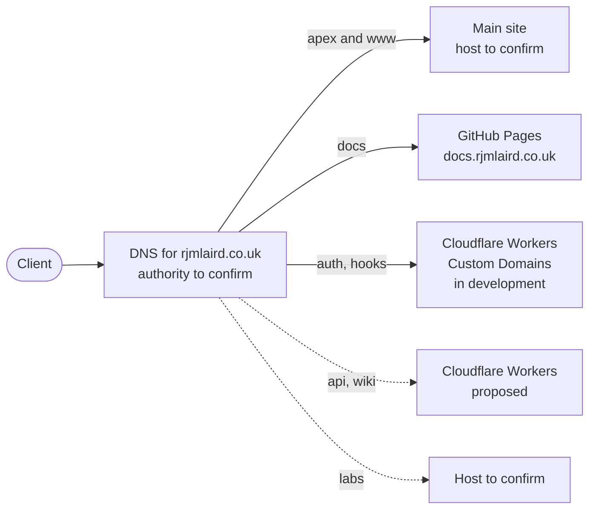

The domain architecture of rjmlaird.co.uk is intended to keep DNS small, predictable and easy to audit. This page records what is known about the current setup, what is inferred, and the rules that decide whether a new subdomain gets created.

:::info[Status: Draft]
Only the docs hostname is verified from a repository. The registrar and authoritative nameservers are **not yet documented**. Treat everything marked *inferred* or *To confirm* as unchecked.
:::

## Global DNS strategy

| Question | Answer | Basis |
| --- | --- | --- |
| Who is the registrar? | To confirm | Not recorded |
| Who runs the authoritative nameservers? | Probably Cloudflare | **Inferred**: the auth Worker uses a Custom Domain route, which requires the zone's DNS to be managed by Cloudflare |
| How does `docs` resolve? | CNAME to GitHub Pages | Repository README and `static/CNAME` |
| How do Worker hostnames resolve? | Cloudflare Worker Custom Domains | Owner-stated for `auth` and `hooks` |
| Is there a wildcard DNS record? | To confirm | Not recorded |
| Is DNSSEC enabled? | To confirm | Not recorded |

The practical consequence is a **split hosting model**. Static content may live on GitHub Pages or another static host, while services live on Cloudflare Workers. DNS is the one place that holds the whole picture together, which is why it deserves its own documentation.

## Root domain and apex routing

The planning inventory names `www.rjmlaird.co.uk` as the canonical web presence and `rjmlaird.co.uk` as the root domain.

**Proposed rule:** pick one canonical host and permanently redirect (301) the other to it. Following the inventory, that means:

- `https://www.rjmlaird.co.uk` serves the site.
- `https://rjmlaird.co.uk` redirects to `https://www.rjmlaird.co.uk`, preserving the path.

**Trade-offs.** Using `www` as canonical is the traditional choice and keeps the apex record simple. Using the apex as canonical gives shorter URLs and matches how the site is already referred to elsewhere. Either works; what matters is choosing one and applying it everywhere, including sitemaps, `rel="canonical"` tags and cookie scope.

:::note[To confirm / technical debt]
The docs site currently links to the **apex** (`https://rjmlaird.co.uk`) in its navbar and footer, which contradicts the inventory's choice of `www` as canonical. Decide which host is canonical, then update `docusaurus.config.ts` to match. Record the decision in an [ADR](./adrs/index.md).
:::

## Subdomain resolution rules

1. **Lowercase, single-label, one purpose.** For example `docs`, never `docs-and-guides`. Names describe a function, not a vendor.
2. **No subdomain without a catalogue entry.** Every record must correspond to a row in the [subdomain catalogue](./subdomain-catalogue.md) with a status and an owner.
3. **No wildcard DNS record.** A wildcard hides typos and widens the takeover surface. (The shared session cookie is scoped to `*.rjmlaird.co.uk`, but that is a cookie setting, not a DNS record.)
4. **Remove records when retiring a service.** A CNAME pointing at a deleted GitHub Pages site or an abandoned SaaS tenant can be claimed by someone else. Delete the DNS record in the same change that retires the service.
5. **Prefer redirects to new hostnames.** A retired subdomain should redirect to its path replacement for as long as old links are likely to exist, then be removed.

### Record patterns in use or planned

| Pattern | Used by | Status |
| --- | --- | --- |
| CNAME to a GitHub Pages hostname | `docs` | Live (per README; confirm in the DNS provider) |
| Worker Custom Domain (record managed by Cloudflare) | `auth`, `hooks` | In development |
| Worker Custom Domain | `api`, `wiki` | Proposed |
| Apex and `www` | Main site | Live; host to confirm |
| CNAME to an external SaaS | Possibly `newsletter`, `booking` | Deferred; depends on provider support |

## Naming, classification and lifecycle

Every service has one name, one primary classification, one visibility and one lifecycle. The controlled values and their meanings are defined in the [subdomain catalogue](./subdomain-catalogue.md#fields); this page sets the principles.

| Principle | Rule |
| --- | --- |
| Naming | The slug names a function, not a vendor or a technology |
| Classification | Exactly one primary classification. Related services are linked, never duplicated |
| Visibility | Declared explicitly. Protocol, integration, ingestion and management services are restricted by default |
| Lifecycle | `planned`, `reserved`, `active` or `retired`. Moving to `active` needs evidence from a repository or a check |
| Ownership | Each service has a named owner and a place where its code lives. Ownership is recorded in the service's page or repository, not in DNS |
| Retirement | Remove the DNS record in the same change that retires the service |

## Certificate management and edge security

| Hostname type | Certificate | Notes |
| --- | --- | --- |
| GitHub Pages custom domain | Issued and renewed by GitHub | The README instructs enabling **Enforce HTTPS** |
| Worker Custom Domain | Issued by Cloudflare | Managed automatically |
| Main site | To confirm | Depends on host |

Candidate hardening steps, none of which are confirmed as in place:

- **CAA records** limiting which certificate authorities may issue for the domain.
- **HSTS** on every hostname once all are HTTPS-only. Note that GitHub Pages cannot set custom response headers (see [Security, privacy and access control](./security-privacy-access.md)).
- **DNSSEC**, if supported by both the registrar and the DNS provider.

:::note[To confirm]
Whether the `docs` record is proxied through Cloudflare or DNS-only. Proxying a GitHub Pages hostname can affect how GitHub issues and renews its certificate, so the setting should be recorded here.
:::

## Routing diagram

Solid lines are confirmed or in development. Dotted lines are proposed or unconfirmed.

## Typographical error in the planning inventory

The original inventory lists `tutoring.rjmlaild.co.uk` (with an extra "l"). That is a different, unowned domain. The intended hostname is `tutoring.rjmlaird.co.uk`, which is itself recommended to be [merged into a path](./subdomain-planning-inventory.md#recommended-simplification) rather than created.

## Open questions

1. Where is `rjmlaird.co.uk` registered?
2. Is Cloudflare the authoritative DNS provider for the whole zone?
3. Is the `docs` record proxied or DNS-only?
4. Is there a wildcard record, or any dangling record from earlier experiments?
5. Is DNSSEC enabled, and are CAA records set?
6. Which host is canonical, apex or `www`, and does the other redirect today?

## Related pages

- [Subdomain catalogue](./subdomain-catalogue.md)
- [Environments and deployment model](./environments.md)
- [Security, privacy and access control](./security-privacy-access.md)
