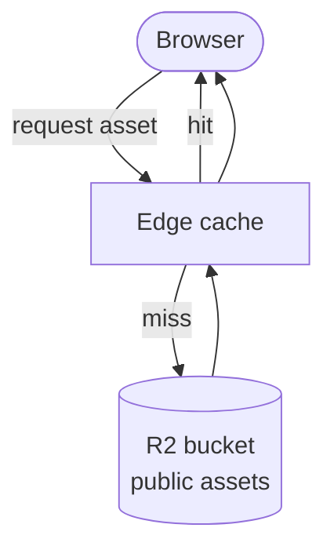

This page sets out how media and static assets should be stored and delivered. Very little of it is built. The one confirmed use of object storage is a Cloudflare R2 bucket for Zotero files. Everything else is a proposal.

:::info[Status: Proposed]
No `cdn`, `images`, `dam` or `upload` subdomain is verified as live. This page recommends against creating most of them.
:::

## Current state

| Concern | Today | Evidence |
| --- | --- | --- |
| Assets for the docs | Served from the GitHub Pages build alongside the pages | Repository |
| Assets for the main site | To confirm | None |
| Object storage | Cloudflare R2, used for Zotero file sync and research ingest | Owner-stated |
| Image optimisation | To confirm | None |

## Proposal: one asset host, only if needed

The inventory lists four infrastructure hostnames for media: `cdn`, `dam`, `images` and `upload`. They should collapse into **at most one**.

| Hostname | Recommendation | Reason |
| --- | --- | --- |
| `cdn` (or `assets`) | Later, if needed | A single public bucket on a custom domain is enough |
| `images` | Merge into the asset host | Transformations are a feature of the host, not a separate site |
| `dam` | Avoid | Naming conventions and folders in object storage cover a one-person workflow |
| `upload` | Avoid | Untrusted uploads under a shared-cookie domain are a risk; if uploads are ever needed, use an authenticated route on the API |

Most images used by a site should simply be built into that site by its generator. A separate asset host is only worth it for large, shared or frequently changing media.

## Candidate delivery flow

Image transformation (resizing, format conversion) is a candidate addition between the cache and the bucket. Which tool to use, and its cost on the current Cloudflare plan, is **To confirm**.

## Caching policy (proposed)

- **Fingerprinted files** (a hash in the filename) can be cached for a long time and marked immutable.
- **Unversioned files** should have short cache lifetimes or revalidation.
- **Private buckets** (such as the Zotero store) must never share a bucket, a domain or caching rules with public assets.

## To confirm

1. Where do main-site images live today?
2. Is any public R2 bucket exposed on a custom domain?
3. Is there a need for resized images beyond what the site generator produces?

## Related pages

- [Subdomain catalogue](./subdomain-catalogue.md)
- [Content platform architecture](./content-platform.md)
- [Security, privacy and access control](./security-privacy-access.md)
