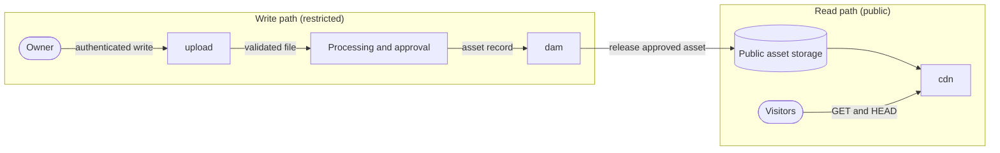

This page sets out how assets are meant to flow between the asset services, and where public delivery stops. Little of it is built; the one confirmed use of object storage is a Cloudflare R2 bucket for Zotero files.

:::info[Status: Proposed]
No `cdn`, `dam` or `upload` hostname is verified as live. The services are catalogued as planned; see the [generated catalogue](./generated/subdomain-catalogue.md).
:::

## Roles

| Service | Responsibility | Direction | Access |
| --- | --- | --- | --- |
| [upload](../services/platform/upload.md) | Accept and validate controlled writes | Write | Restricted |
| Processing and approval | Check, transform and approve assets | Write | Restricted |
| [dam](../services/platform/dam.md) | Hold metadata, rights and approval; release assets for publication | Write and govern | Restricted |
| [cdn](../services/platform/cdn.md) | Deliver approved public assets | Read | Public, read-only |
| [dav](../services/platform/dav.md) | Store Zotero attachments privately | Separate | Restricted |

## Asset flow

The write path and the read path share nothing except the approved asset that `dam` releases. `cdn` never accepts writes, and `upload` never delivers files.

## Rules

1. **Nothing is public until approved.** An uploaded file stays unpublished until it has passed processing and `dam` releases it.
2. **Separate storage.** Private buckets, including the Zotero store, never share a bucket, domain or cache rules with public assets.
3. **No uploaded content is served from the upload host.** The shared session cookie makes every subdomain one trust zone; see [Security, privacy and access](./security-privacy-access.md#the-shared-session-cookie).
4. **One direction.** Assets move upload, then processing, then `dam`, then `cdn`. Nothing moves back.

## Earlier recommendation

The [planning inventory](./subdomain-planning-inventory.md) recommended against `dam` and `upload` hostnames and for at most one asset host. The platform services plan supersedes that for the asset services. Record the decision and its mitigations in an ADR before moving any of them to `active`.

## Current state

| Concern | Today | Evidence |
| --- | --- | --- |
| Assets for the docs | Served from the GitHub Pages build alongside the pages | Repository |
| Assets for the main site | To confirm | None |
| Object storage | Cloudflare R2, used for Zotero file sync and research ingest | Owner-stated |
| Image optimisation | To confirm | None |

## Caching policy (proposed)

- **Fingerprinted files** (a hash in the filename) can be cached for a long time and marked immutable.
- **Unversioned files** should have short cache lifetimes or revalidation.
- **Private buckets** (such as the Zotero store) must never share a bucket, a domain or caching rules with public assets.

## To confirm

1. Where do main-site images live today?
2. Is any public R2 bucket exposed on a custom domain?
3. Is there a need for resized images beyond what the site generator produces?

## Related pages

- [Subdomain catalogue](./subdomain-catalogue.md)
- [Platform services](../services/platform/overview.md)
- [Content platform architecture](./content-platform.md)
- [Security, privacy and access control](./security-privacy-access.md)
