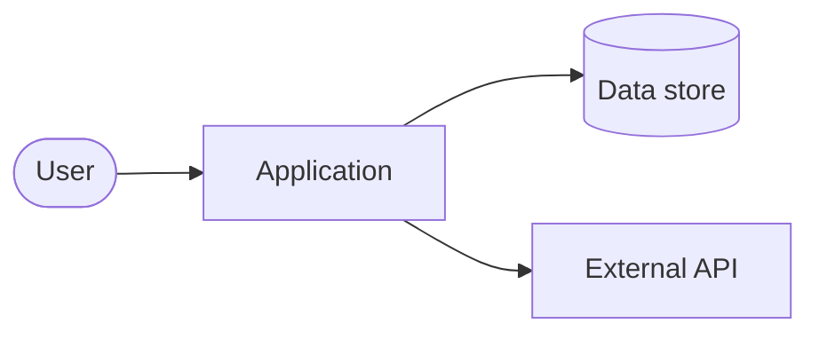

Describe the system at three levels: context (who and what it talks to), containers (the deployable parts) and components (the main modules inside each part).

## System context

## Design decisions

Record significant decisions as short notes: the context, the decision, and the consequences. Link to the relevant issue or pull request.

| Decision | Status | Date |
| --- | --- | --- |
| Example: use a static site generator for docs | Accepted | 2026-10 |
