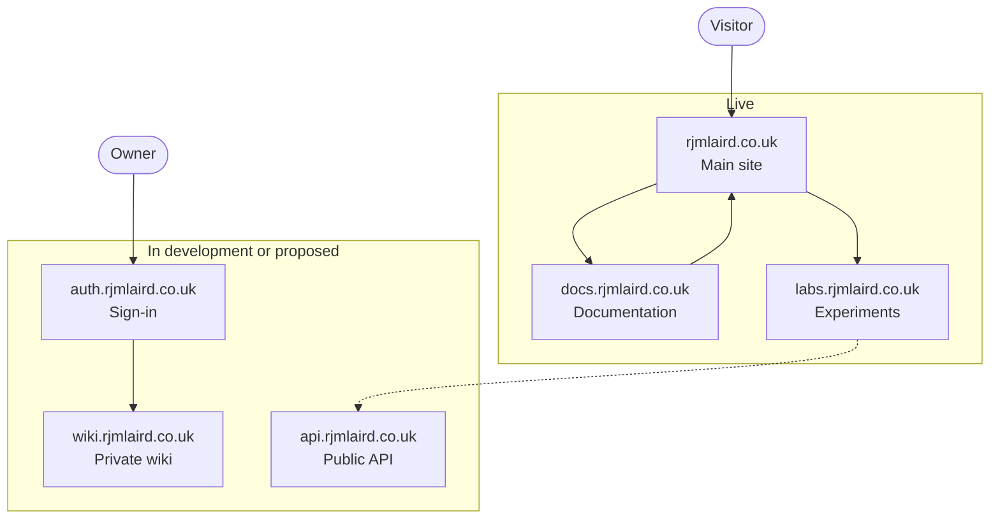

This section documents the architecture behind **rjmlaird.co.uk**: the sites, services and infrastructure that make up Ryan Laird's personal, professional and technical web presence. It is written for four readers: the owner and maintainer, future collaborators and contractors, technical readers who want to see how the pieces fit, and non-technical readers who only need a mental model.

:::warning[Read the status labels]
The subdomain list that this section is built around is a **planning model**, not an inventory of running services. Every site and service carries a status label, and anything not yet checked is marked **To confirm**. If a page does not say something is *Live*, do not assume it is.
:::

## How to read this section

### Status labels

| Label | Meaning |
| --- | --- |
| **Live** | Serving real traffic today. |
| **In development** | Being built; not yet serving production traffic. |
| **Proposed** | Designed or recommended, but no build has started. |
| **Deferred** | Deliberately postponed until there is a concrete need. Includes exploratory ideas. |
| **Not recommended** | Considered and advised against. Recorded so the question is not reopened by accident. |
| **Deprecated** | Was live; scheduled for removal or already retired. |

### Confidence labels

Each page also carries a `confidence` value in its front matter: **Verified** (checked against a repository or configuration), **Partly verified**, or **Unverified** (from planning notes only). Where a statement is inferred rather than confirmed, it is flagged inline.

## System vision and scope

The ecosystem exists to do five jobs:

1. **Present** a clear professional and personal brand.
2. **Publish** writing, research and astronomy and space communication.
3. **Sell and schedule** services such as tutoring, mentoring and coaching.
4. **Explore** ideas in public through experiments and data pieces.
5. **Run** a small amount of back-office automation behind the scenes.

**In scope:** the public sites, the services and APIs, the documentation site and the infrastructure that connects them.

**Out of scope:** the internals of third-party platforms (GitHub, Stripe, Cal.com, HubSpot, Notion, Zotero). Only the integration points are documented here.

## Guiding principles

1. **Status before subdomain.** Nothing gets a DNS record until it has a catalogue entry with a purpose, a status and an owner.
2. **Paths before subdomains.** Content that shares a build, an audience and a security boundary belongs at a path on the main site. A subdomain must justify itself (see the [subdomain catalogue](./subdomain-catalogue.md#when-a-subdomain-is-justified)).
3. **Static first.** Use a static site wherever possible. Add a Worker only where server-side behaviour is genuinely needed.
4. **Keep public and private surfaces apart.** The public portfolio API and the commercial webhook services are separate systems. Private tools sit behind authentication.
5. **One brand system.** `global.css` on the main site is the single source of truth for the visual identity. Other sites copy from it, never the reverse.
6. **Say what we do not know.** Unknowns are written down as **To confirm**, not papered over.
7. **Prefer reversible, low-cost choices.** This is a one-person operation; every extra moving part is maintenance debt.

## Ecosystem summary

This table lists the surfaces with some evidence behind them. The full list, including purely planned subdomains, is in the [subdomain catalogue](./subdomain-catalogue.md).

| Surface | Role | Status | Evidence | Platform |
| --- | --- | --- | --- | --- |
| `rjmlaird.co.uk` / `www` | Canonical site and brand hub | Live | Owner-stated | Astro; hosting to confirm |
| `docs.rjmlaird.co.uk` | This documentation | Live | Repository | Docusaurus on GitHub Pages |
| `labs.rjmlaird.co.uk` | Experiments and data pieces | Live (to confirm) | Linked from the docs navbar | To confirm |
| `auth.rjmlaird.co.uk` | Central GitHub sign-in | In development | Owner-stated | Cloudflare Worker, Hono, KV |
| `hooks.rjmlaird.co.uk` | Webhook ingress for Stripe, Cal.com and HubSpot | In development | Owner-stated (private repo) | Workers, Queues, D1 |
| `api.rjmlaird.co.uk` | Public portfolio API | Proposed | Owner-stated (separate repo); deployment to confirm | Cloudflare Worker (candidate) |
| `wiki.rjmlaird.co.uk` | Private Notion-backed wiki | Proposed | Architecture agreed; build started | Astro, Workers, D1, Cloudflare Access |

## A mental model for non-technical readers

Think of the ecosystem as a shop with four areas:

- **The shop windows** are the public sites: the main site, the docs, the labs and, later, space and research content. Visitors browse them freely.
- **The locked doors** are the sign-in service and the private wiki. Only the owner gets through.
- **The back office** is the set of small services that receive a payment or a booking, record it and update the customer record, without anyone pressing a button.
- **The filing cabinets** are the databases and storage buckets where those services keep their records and files.

## Core technologies

| Technology | Used for | Evidence |
| --- | --- | --- |
| Astro | Main site (`Layout.astro`, `Head.astro`, `global.css`) | Owner-stated |
| Docusaurus 3.10.2 (React 19, Mermaid, local search) | Documentation site | Repository |
| GitHub Pages and GitHub Actions | Hosting and deployment of the docs | Repository |
| pnpm 10 and Node.js 22 (in CI) | Package management and builds | Repository |
| Cloudflare Workers, Hono, KV, D1, R2, Queues, Access | Services and APIs | Owner-stated across several repositories |
| TypeScript, Zod, Vitest, Wrangler | Service code, validation, tests, deployment | Owner-stated |
| GitHub OAuth, Stripe, Cal.com, HubSpot, Notion, Zotero | Third-party integrations | Owner-stated |

## User journey

Dotted lines are candidate relationships. Solid lines to anything in the second group describe the intended design, not a deployed system.

:::note[To confirm]
- Which host serves the main site, and whether it is served from the apex or `www`.
- Whether `labs.rjmlaird.co.uk` is deployed from its own repository and where.
- Whether `api.rjmlaird.co.uk` is deployed yet.

See [Domain and DNS model](./domain-model.md) for the full list of open questions.
:::

## In this section

- [Domain and DNS model](./domain-model.md)
- [Subdomain catalogue](./subdomain-catalogue.md)
- [Environments and deployment model](./environments.md)
- [Content platform architecture](./content-platform.md)
- [Media, assets and CDN strategy](./media-assets-cdn.md)
- [APIs and integrations](./apis-integrations.md)
- [Automation and workflows](./automation-workflows.md)
- [Security, privacy and access control](./security-privacy-access.md)
- [Observability, status and incident response](./observability-status.md)
- [Naming conventions and standards](./standards.md)
- [Roadmap and decision log](./roadmap.md)
