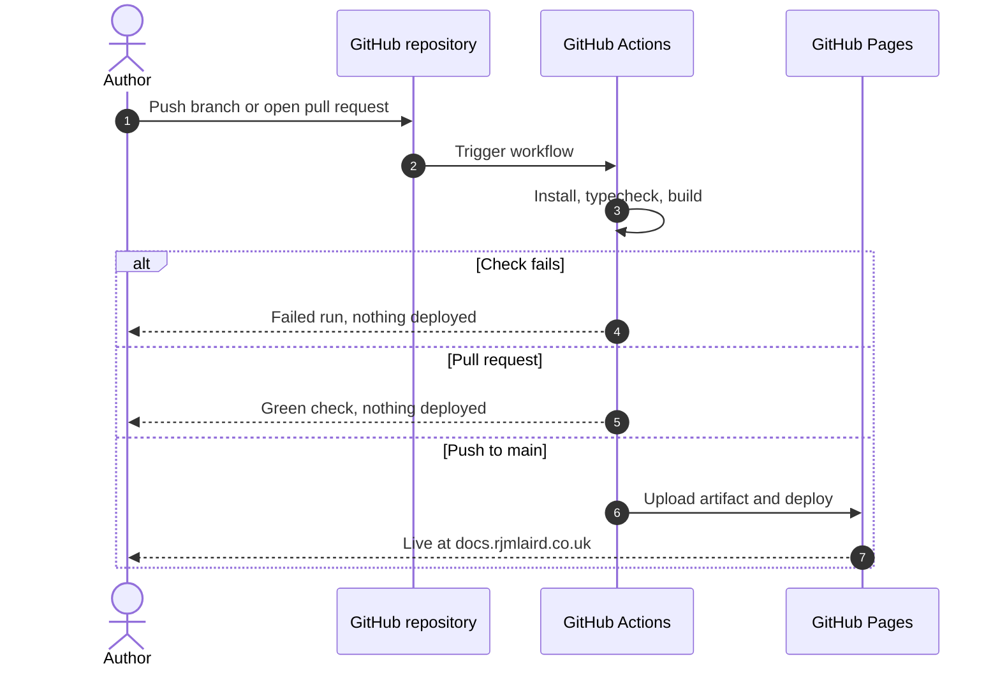
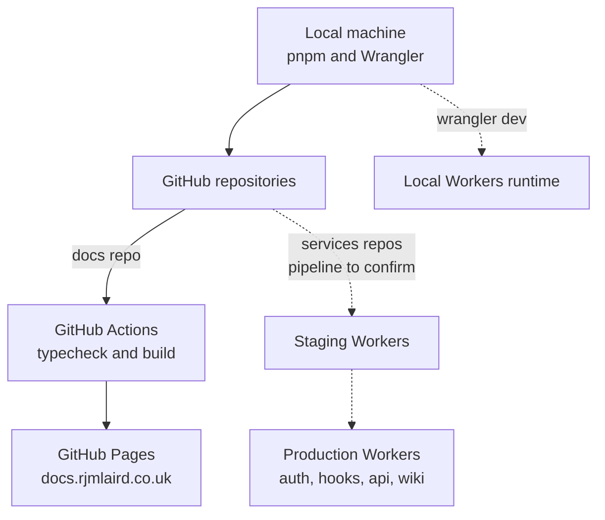

Changes to the rjmlaird.co.uk ecosystem flow from a local machine, through an automated check, to production. This page documents the pipeline that is verified today (the docs site), the environment model planned for the Workers services, and the places where the two differ.

## Local development workflows

### Docs site (verified)

The docs repository uses pnpm, with the version pinned in `package.json` through `packageManager` (enable it with `corepack enable`). Node.js 20 or later is required locally.

```bash title="Local commands"
pnpm install
pnpm start          # live preview at http://localhost:3000
pnpm run build      # production build; fails on broken links
pnpm run typecheck  # TypeScript check
pnpm validate       # typecheck plus build; what CI runs
```

### Workers services (owner-stated)

The services repositories are pnpm workspace monorepos written in TypeScript. Wrangler runs Workers locally and deploys them; Vitest runs the tests. Exact local commands are **To confirm** and should be added to each repository's README.

## CI/CD pipeline architecture

### Docs site (verified)

The workflow is `.github/workflows/ci.yml`.

| Aspect | Setting |
| --- | --- |
| Triggers | Push to `main`, any pull request, and manual dispatch |
| Build job | Checkout, pnpm setup, Node.js 22 with the pnpm cache, `pnpm install --frozen-lockfile`, then `pnpm run validate` |
| Deploy job | Runs only on a push to `main`, after the build job succeeds |
| Hosting | GitHub Pages through the official Pages actions, with the `build` directory as the artifact |
| Permissions | `contents: read`, `pages: write`, `id-token: write` |
| Concurrency | One run at a time in the `pages` group; in-progress runs are not cancelled |

Two settings make the pipeline strict by design: `onBrokenLinks: 'throw'` and `onBrokenMarkdownLinks: 'throw'`. A broken internal link therefore fails the build, and a failed build never reaches production. Broken anchors only warn.



### Workers services (to confirm)

The CI and deployment pipeline for the Workers repositories is not yet documented. The intended shape, based on the owner's plans, is Wrangler-based deployment per environment with tests run first.

:::note[To confirm]
Whether Worker deployments run from GitHub Actions or from a local `wrangler deploy`, and which credentials they use.
:::

## Preview environments and branching strategy

| Surface | Environments | Preview URLs |
| --- | --- | --- |
| Docs site | One: production | **None.** Pull requests run a build check, but nothing is deployed for review |
| `rjmlaird-services` | Development, staging, production (owner-stated plan) | Staging serves as the preview |
| Other Workers | To confirm | To confirm |
| Main site | To confirm | To confirm |

**Branching.** The docs repository uses a single long-lived branch, `main`. Work happens on short-lived branches and reaches `main` through a pull request. Direct pushes to `main` also deploy, so protect the branch if more than one person contributes.

**Rollback.** Revert the commit on `main`. The workflow redeploys the previous state. For Workers, redeploy the previous version with Wrangler, or use the platform's version history.

**Versioned docs.** The documentation can be frozen at a release with `pnpm run version:cut`. The architecture section describes the *current* system, so decide whether it should be snapshotted along with product documentation (see the technical debt below).

## Production edge deployment



Dotted lines are planned or unconfirmed.

## Secrets and configuration

- The docs workflow uses no repository secrets. It relies on the built-in token and the Pages deployment permissions.
- Worker secrets are intended to live as **Cloudflare Worker secrets**, never in the repository. The wiki's Notion token is the stated example.
- Environment-specific values belong in Wrangler configuration per environment. Anything secret never does.

## Technical debt and open questions

:::note[To confirm / technical debt]
1. **Shallow checkout.** The workflow uses the default `actions/checkout@v4`, which fetches only the latest commit. The docs show last-updated times (`showLastUpdateTime: true`), which are read from git history. With a shallow clone those times are likely to be wrong. Setting `fetch-depth: 0` on the checkout step is the usual fix. Verify against the live site.
2. **Duplicate `CNAME` file.** There is a `CNAME` at the repository root as well as `static/CNAME`. Only the one in `static/` is copied into the build. Confirm the root copy is intentional.
3. **No preview deployments.** Reviewing a docs change means running it locally.
4. **Actions pinned to major tags.** Pinning to commit hashes is stricter, at the cost of manual updates.
5. **Versioning scope.** Decide whether the `architecture` section is included in `version:cut` snapshots.
:::

## Related pages

- [Content platform architecture](../architecture/content-platform.md)
- [Observability, status and incident response](../../operate/status-and-observability.md)
- [Security, privacy and access control](security-and-privacy.md)
