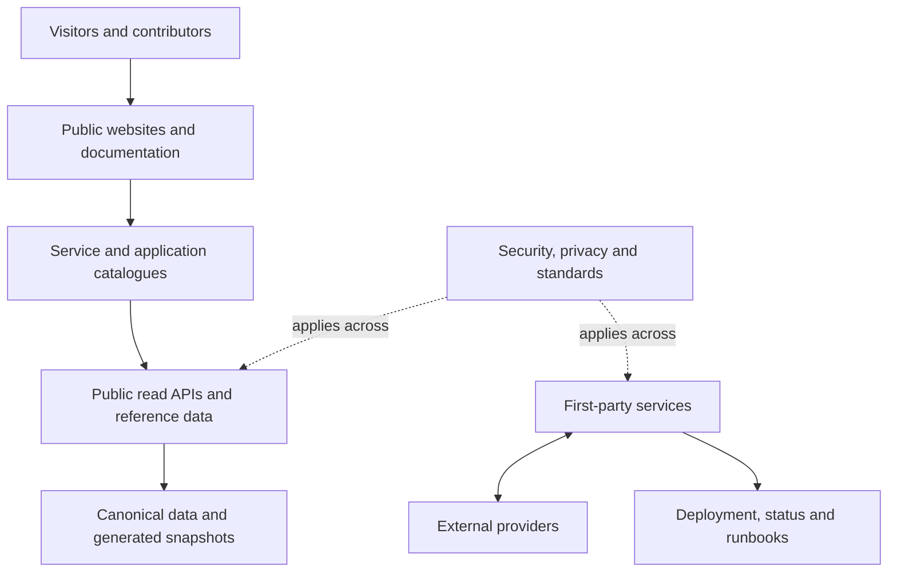

# Platform map

The platform is documented in layers so that shared design is not confused with a service implementation.

This is a conceptual map, not a live dependency graph. Check each [first-party service record](../catalogue/first-party/index.md) for lifecycle, dependencies and evidence. External vendors are recorded separately in the [integration catalogue](../catalogue/index.md#external-integrations).

## Where to find details

- Cross-cutting patterns: [platform architecture](../platform/overview.md).
- Hostnames, lifecycle and visibility: [subdomain governance](../platform/governance/subdomains.md) and the [generated catalogue](../catalogue/generated/subdomain-catalogue.md).
- API and data contracts: [build reference](../build/reference/http-contracts.md).
- Routine operational procedures: [runbooks](../operate/runbooks/secret-rotation.md).
