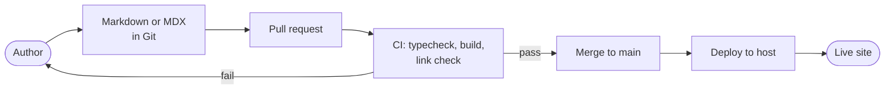

Content across the ecosystem is written as plain files in Git, built into static pages and deployed automatically. This page explains the frameworks involved, how the two main sites share a visual identity, and where the content model is still undefined.

## Static site generation and frameworks

| Site | Framework | Content source | Status |
| --- | --- | --- | --- |
| Main site (`rjmlaird.co.uk`) | Astro | To confirm (for example Markdown or content collections) | Live (owner-stated) |
| Docs (`docs.rjmlaird.co.uk`) | Astro Starlight | Markdown and MDX in `src/content/docs/` | Live (repository) |
| Labs (`labs.rjmlaird.co.uk`) | To confirm | To confirm | Live (linked) |
| Wiki (`wiki.rjmlaird.co.uk`) | Quartz (static) | Markdown knowledge base | Live (owner-stated) |

Three tools are in use deliberately. Astro suits a bespoke, design-led main site. Starlight, which is built on Astro, provides navigation, search and accessible defaults for documentation, and Quartz publishes the Markdown knowledge base.

## Docs content model (verified)

| Element | Where it lives |
| --- | --- |
| Pages | `src/content/docs/**/*.{md,mdx}`, with front matter |
| Navigation | `sidebar` in `astro.config.mjs`, mixing explicit items and autogenerated groups |
| Site settings | `astro.config.mjs` |
| Landing page cards | `src/content/docs/index.mdx` |
| Brand tokens and theme overrides | `src/styles/brand.css` |
| Diagrams | Mermaid code blocks inside Markdown |
| Search | Pagefind, built at build time (no external search service) |
| Language and locale | British English (`en-GB`) |
| Licence | Documentation under CC BY 4.0 (stated in the footer) |

Pages in an autogenerated sidebar group appear automatically; others must be listed in `astro.config.mjs`. The build fails if any internal link or anchor is broken.

## Structured content and type validation

Type-safe validation with **Zod** is used in the services code (the shared service contracts package, owner-stated). Whether the main site validates content with Astro content collections and Zod schemas is **not yet documented**.

:::note[To confirm]
- Whether the main site uses Astro content collections, and with which schemas.
- Whether the CV, portfolio and research content have a structured data format, or are ordinary pages.
- Where Zotero-derived research data is meant to surface on the site.
:::

## The shared brand system

The main site's `src/styles/global.css` is the **single source of truth** for the brand: an ink, teal, amber and violet palette, with Space Grotesk, Inter and JetBrains Mono typography, designed to meet WCAG AA or better. The `rjmlaird-dev` project shares the same file.

The docs site reproduces the brand in `src/css/custom.css` and loads the three fonts from Google Fonts.

:::note[To confirm / technical debt]
The docs repository's README states that `custom.css` holds **placeholder** hex values to be copied by hand from `global.css`. Until that is done, the two sites do not match, and every future brand change needs a manual copy. Candidate fixes, in order of effort:

1. Copy the values once and note the date here.
2. Publish the tokens as a small package or a single hosted CSS file that both sites import.
3. Generate both stylesheets from one tokens file.

The docs now self-host Inter, Space Grotesk and JetBrains Mono through Fontsource, so no third-party font request is made.
:::

## Content authoring and Markdown workflows

1. Write or edit Markdown (or MDX) on a branch.
2. Preview locally with `pnpm dev`.
3. Open a pull request; CI typechecks and builds, failing on broken links.
4. Merge to `main`; the site deploys.

### Authoring notes for MDX

`.md` files are plain Markdown. In `.mdx` files, curly braces and angle brackets in prose are read as code, so put them in backticks or a code block. This is the most common cause of a failed `.mdx` build.

## Related pages

- [Media, assets and CDN strategy](/platform/architecture/media-and-assets/)
- [APIs and integrations](/platform/architecture/apis-and-integrations/)
- [Naming conventions and standards](/platform/governance/standards/)
