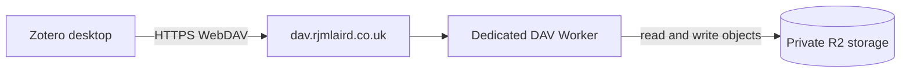

# dav.rjmlaird.co.uk

:::info[Lifecycle: planned]
This service is planned. It is documented from its intended scope and has not been verified as deployed in this repository. Do not treat it as a live interface until the [catalogue](../generated/subdomain-catalogue.md) says it is active.
:::

## Purpose

`dav.rjmlaird.co.uk` is private WebDAV-compatible storage for Zotero attachment synchronisation. Its single responsibility is to store and serve those attachments to the approved client.

It is not a public file host, CDN, public API or general document-management system.

## At a glance

| Field | Value |
| --- | --- |
| Hostname | `dav.rjmlaird.co.uk` |
| Classification | Storage |
| Visibility | Restricted |
| Lifecycle | Planned |
| Evidence | Owner-stated; not verified in this repository |
| Catalogue | [Generated public service catalogue](../generated/subdomain-catalogue.md) |

## What it provides

- WebDAV-compatible storage for Zotero attachments
- The read, write, list and delete operations needed for synchronisation
- A stable hostname to configure in Zotero's sync settings

Zotero adds its own `/zotero` path to a WebDAV address, so the configured address should normally be the hostname root. See [Zotero's sync guidance](https://www.zotero.org/support/sync).

## Storage architecture

The Worker is bound only to the storage it needs. Nothing here is exposed publicly.

## Supported methods

Only the methods the approved client needs are implemented.

| Method | Use |
| --- | --- |
| `OPTIONS` | Capability discovery |
| `PROPFIND` | List and describe files |
| `GET`, `HEAD` | Read |
| `PUT` | Write |
| `DELETE` | Remove |
| `MKCOL` | Create folders |
| `MOVE` | Only if the client requires it |

Unsupported methods return an appropriate error. Operations outside the DAV root are rejected.

## Boundaries

This service does not:

- Provide any public browsing, indexing or download interface
- Publish content through [cdn](cdn.md) or expose it through [api](api.md)
- Act as the source of bibliographic metadata, which Zotero and any approved research workflow manage; it stores attachment files only

## Access model

Anonymous access is not allowed.

| Client | Approach |
| --- | --- |
| Zotero desktop | Dedicated WebDAV credentials |
| Browser | Denied, or protected by Cloudflare Access |
| Administrative automation | Cloudflare Access service token or narrowly scoped credentials |
| Public | Denied |

## Security considerations

- Require HTTPS for every request
- Keep storage private; never expose a public development URL
- Use a dedicated Worker, separate from the public API
- Hold credentials as Worker secrets, never in Git
- Never log bodies, file contents or credentials
- Enforce an attachment-size limit
- Return non-cacheable responses for private content
- Reject path traversal and anything outside the DAV root
- Monitor availability without exposing a listing

## Dependencies

- A dedicated Cloudflare Worker and private object storage
- Worker secrets for credentials

## Operations

- [Deployment and environments](../../platform/governance/environments.md)
- [Security, privacy and access](../../platform/governance/security-and-privacy.md)
- [Observability and status](../../operate/status-and-observability.md)
- [Adding or changing a service](../../build/adding-a-service.md)

## Related services

- [auth.rjmlaird.co.uk](auth.md)
- [dam.rjmlaird.co.uk](dam.md)
- [upload.rjmlaird.co.uk](upload.md)
- [cdn.rjmlaird.co.uk](cdn.md)
