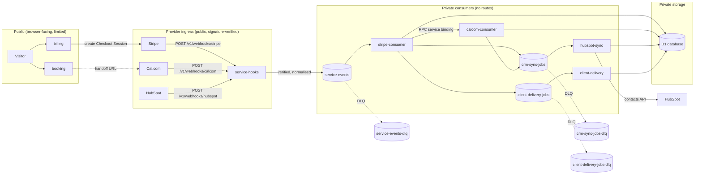

The services system is a set of small Cloudflare Workers joined by queues. Browser-facing Workers are kept separate from provider ingress, and both are kept separate from the private consumers that touch storage. This page explains that separation and the delivery guarantees that follow from it.

## System diagram

The D1 tables are listed in the [data model](../../build/reference/data-model.md).

## Trust boundaries

1. **Public API** (`booking`, `billing`). Browsers are untrusted. Routes and methods are allow-listed, CORS origins are explicit, request bodies are validated with strict Zod schemas and requests are rate limited. No stored data can be read through these Workers.
2. **Provider ingress** (`service-hooks`). A request is untrusted until its signature verifies over the raw body. The Worker holds only the webhook secrets and a queue producer: no D1, no provider API tokens.
3. **Private consumers.** No routes. They are reachable only through queues and one service binding.
4. **Private storage** (D1 and queues). Never exposed over HTTP. D1 holds no card data, no raw provider payloads and no email addresses.

## Least privilege

Each Worker is bound only to what it needs.

| Worker | Queues | D1 | Service bindings | Secrets |
| --- | --- | --- | --- | --- |
| `service-hooks` | Produces `service-events` | No | No | Stripe, Cal.com and HubSpot webhook secrets |
| `booking` | None | No | No | None |
| `billing` | None | No | No | `STRIPE_SECRET_KEY`, `STRIPE_PRICE_*` |
| `stripe-consumer` | Consumes `service-events`; produces CRM, delivery and DLQ messages | Yes | `calcom-consumer` | None |
| `calcom-consumer` | Produces `crm-sync-jobs` | Yes | No | None |
| `hubspot-sync` | Consumes `crm-sync-jobs`; produces its DLQ | Yes | No | `HUBSPOT_ACCESS_TOKEN` |
| `client-delivery` | Consumes `client-delivery-jobs`; produces its DLQ | Yes | No | None (adapter-specific later) |

Secret names and where to set them are in the [configuration reference](../../build/reference/service-configuration.md).

## Delivery semantics

Queues deliver at least once, so every consumer is idempotent.

- `webhook_events` has a unique constraint on `(provider, provider_event_id)`. An event already processed is skipped.
- Business state and the "processed" mark commit together in one transaction (`D1.batch()`).
- Downstream messages are enqueued **before** the commit. A crash can therefore duplicate a message but never lose one.
- Duplicates collapse through deterministic event IDs, the unique `delivery_workflows.workflow_key` and HubSpot's email-keyed upsert.
- Payments: `checkout.session.completed` and `payment_intent.succeeded` map to a single `payments` row. Delivery starts only on the first transition to `succeeded`.

Messages that exhaust their retries go to a dead-letter queue (DLQ), one per queue. See the [webhook failures runbook](../../operate/runbooks/webhook-failures.md).

## Admin interface (documented, not built)

Any future admin UI or API belongs in its own Worker behind Cloudflare Access (identity-aware, with SSO and MFA), on a non-public hostname, reading D1 through a read-only binding or a dedicated service binding. It must not be added to `booking`, `billing` or `service-hooks`.

## Not in the MVP

- Customer portal (it needs verified identity; `POST /v1/customer-portal-sessions` returns `501`).
- HubSpot inbound events (the webhook route verifies and acknowledges only).
- Reconciliation of payments to bookings (`payments.booking_id` is reserved).
- Booking reschedules.

## To confirm

:::note[To confirm]
1. Queue and DLQ retention periods, and who is alerted when a DLQ receives a message.
2. Whether one D1 database (plus a staging copy) is shared by the four consumers. The launch checklist implies this.
:::

## Related pages

- [Customer journeys](customer-journeys.md)
- [APIs and integrations](../../platform/architecture/apis-and-integrations.md)
- [Security, privacy and access control](../../platform/governance/security-and-privacy.md)
