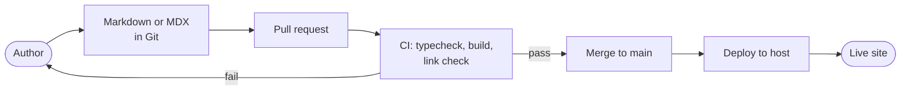

Content across the ecosystem is written as plain files in Git, built into static pages and deployed automatically. This page explains the frameworks involved, how the two main sites share a visual identity, and where the content model is still undefined.

## Static site generation and frameworks

| Site | Framework | Content source | Status |
| --- | --- | --- | --- |
| Main site (`rjmlaird.co.uk`) | Astro | To confirm (for example Markdown or content collections) | Live (owner-stated) |
| Docs (`docs.rjmlaird.co.uk`) | Docusaurus 3.10.2 with React 19 | Markdown in `docs/` | Live (repository) |
| Labs (`labs.rjmlaird.co.uk`) | To confirm | To confirm | Live (linked) |
| Wiki (`wiki.rjmlaird.co.uk`) | Astro with server-side rendering | Notion, synced into D1 | Proposed |

Two frameworks are in use deliberately. Astro suits a bespoke, design-led main site. Docusaurus provides navigation, versioning, search and Mermaid support for documentation without custom work.

## Docs content model (verified)

| Element | Where it lives |
| --- | --- |
| Pages | `docs/**/*.md`, with front matter |
| Navigation | `sidebars.ts`, which is explicit rather than generated |
| Site settings | `docusaurus.config.ts` |
| Landing page project cards | `src/data/projects.ts` |
| Brand tokens and theme overrides | `src/css/custom.css` |
| Diagrams | Mermaid code blocks inside Markdown |
| Search | Local, client-side search plugin (no external search service) |
| Language and locale | British English (`en-GB`) |
| Licence | Documentation under CC BY 4.0 (stated in the footer) |

A page is not visible in the sidebar until it is added to `sidebars.ts`. The build fails if any link points to a page that does not exist.

## Structured content and type validation

Type-safe validation with **Zod** is used in the services code (the shared service contracts package, owner-stated). Whether the main site validates content with Astro content collections and Zod schemas is **not yet documented**.

:::note[To confirm]
- Whether the main site uses Astro content collections, and with which schemas.
- Whether the CV, portfolio and research content have a structured data format, or are ordinary pages.
- Where Zotero-derived research data is meant to surface on the site.
:::

## The shared brand system

The main site's `src/styles/global.css` is the **single source of truth** for the brand: an ink, teal, amber and violet palette, with Space Grotesk, Inter and JetBrains Mono typography, designed to meet WCAG AA or better. The `rjmlaird-dev` project shares the same file.

The docs site reproduces the brand in `src/css/custom.css` and loads the three fonts from Google Fonts.

:::note[To confirm / technical debt]
The docs repository's README states that `custom.css` holds **placeholder** hex values to be copied by hand from `global.css`. Until that is done, the two sites do not match, and every future brand change needs a manual copy. Candidate fixes, in order of effort:

1. Copy the values once and note the date here.
2. Publish the tokens as a small package or a single hosted CSS file that both sites import.
3. Generate both stylesheets from one tokens file.

Also consider self-hosting the fonts. Loading them from Google Fonts makes a third-party request on every docs page view, which should be reflected in the privacy notice.
:::

## Content authoring and Markdown workflows

1. Write or edit Markdown (or MDX) on a branch.
2. Preview locally with `pnpm start`.
3. Open a pull request; CI typechecks and builds, failing on broken links.
4. Merge to `main`; the site deploys.

### Authoring notes for MDX

Docusaurus parses `.md` files as MDX. Curly braces and angle brackets in ordinary prose are read as code, so put them in backticks or a code block. This is the most common cause of a failed docs build.

## Related pages

- [Media, assets and CDN strategy](media-and-assets.md)
- [APIs and integrations](apis-and-integrations.md)
- [Naming conventions and standards](../governance/standards.md)
