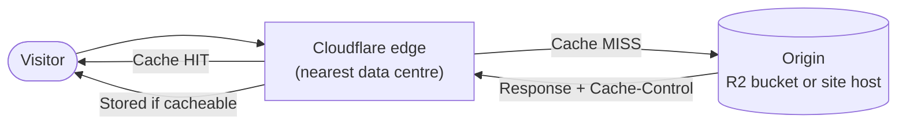
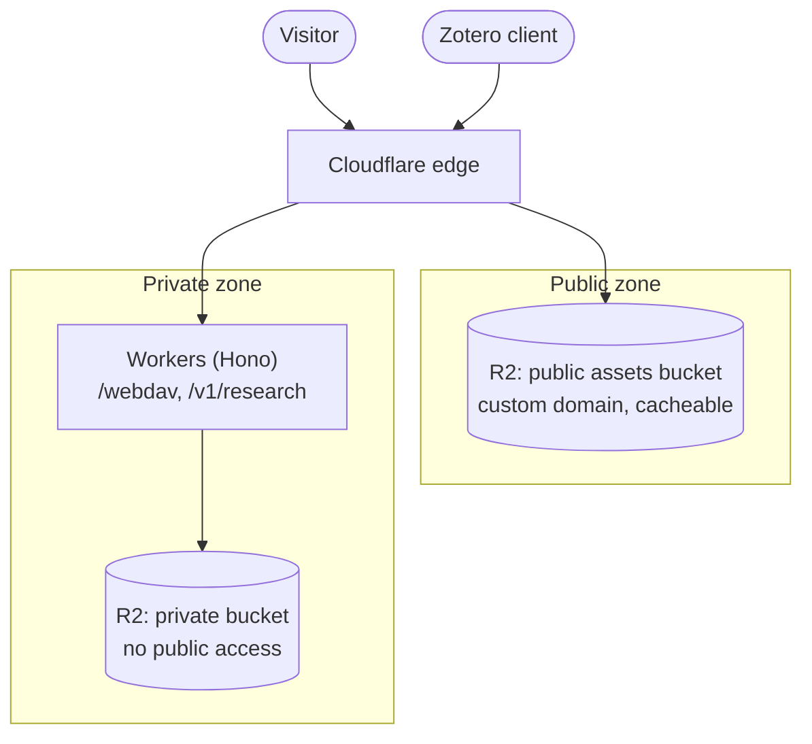
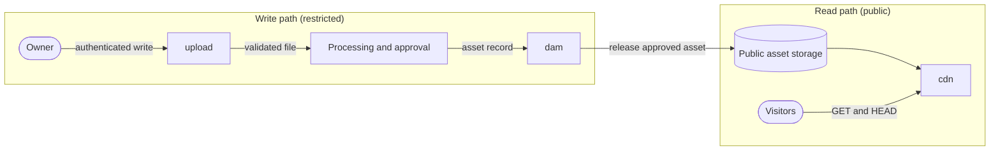

This page explains how media and static assets are stored and delivered, and how Cloudflare's CDN fits into that. It separates what is **verified** from what is **proposed**, because most of the delivery design below has not been built yet.

:::info[Status: Proposed]
The only verified asset workflow is **Cloudflare R2 used as private storage** for Zotero file sync and research ingest. No `cdn`, `assets`, `images`, `dam` or `upload` hostname is confirmed live. Anything marked **To confirm** is unknown, not assumed.
:::

## 1. At a glance

| Layer | Role | Status |
| :--- | :--- | :--- |
| Cloudflare edge cache | Caches static responses close to visitors for any **proxied** hostname | To confirm which hostnames are proxied |
| R2, private storage | Zotero WebDAV files and `papers/` research ingest, served only through Workers | Live (owner-stated) |
| R2, public asset bucket | Public images, downloads and bulk media behind one custom hostname | Proposed |
| Astro build output | Site HTML, CSS, JS and hashed `_astro/` assets | To confirm where it is served from |
| Edge image transformation | Resizing and AVIF/WebP at request time | Deferred |
| `dam`, `upload` hostnames | Digital asset management, public upload endpoint | Avoid |

**Recommendation in one sentence:** serve critical site assets from the main origin, put bulk public media in one public R2 bucket behind one custom hostname with long-lived cache headers, and keep private R2 data in a separate bucket that is never exposed publicly.

## 2. How the CDN path works

A CDN is a network of edge servers that keep copies of static responses near users. A visitor in Leicester is normally answered by a nearby UK or European Cloudflare data centre rather than by the origin.



Three things matter in practice:

- **Only proxied hostnames get the CDN.** In Cloudflare DNS, the orange-cloud (proxied) records route through the edge. Grey-cloud (DNS only) records bypass it entirely, including caching, WAF and rules.
- **Caching is by file type unless told otherwise.** Cloudflare caches common static extensions (images, CSS, JS, fonts, many documents) by default, but **does not cache HTML** unless a Cache Rule says so. The origin's `Cache-Control` header is respected unless a rule overrides it.
- **A cache hit never touches the origin.** That is what protects R2 operation counts and Worker invocations, and why headers matter more than any other setting here.

### Push or pull?

The model you want is **origin pull**, with R2 as the origin:

| | Push CDN | Origin pull (recommended) |
| :--- | :--- | :--- |
| Flow | You upload to the CDN's own storage | The edge fetches from your origin on the first request, then caches |
| Maintenance | You manage uploads and purges for the CDN copy | You upload once to R2, the edge fills itself |
| Fit here | Unnecessary extra step | Matches R2 behind a custom hostname |

You still "push" files to R2 (by CI or `wrangler`), but R2 is the origin, not the CDN. Cloudflare's edge then pulls from it. There is no second copy to manage.

## 3. Storage design

The single most important rule: **public and private data never share a bucket.** R2 public access is configured per bucket, not per folder, so a prefix such as `public/` inside a publicly exposed bucket does not protect the rest of it.



| Bucket | Contents | Access | Cache policy |
| :--- | :--- | :--- | :--- |
| Public assets (proposed name `rjmlaird-assets`) | Images, downloadable PDFs, bulk media, optional fonts | Public via **custom domain only** | Long-lived, immutable where fingerprinted |
| Private (current Zotero and research store) | WebDAV files, `papers/` ingest | Workers binding only, authenticated | `private, no-store`, never edge cached |

**To confirm:** the actual bucket names, whether Zotero WebDAV and `papers/` share one bucket, and that no existing bucket has `r2.dev` or custom-domain public access switched on.

### Public access: custom domain, not `r2.dev`

- **Custom domain** (for example `assets.rjmlaird.co.uk`): gets Cloudflare's cache, WAF, rate limiting and rules. This is the production route. The domain must be on a Cloudflare zone.
- **`r2.dev` URL:** intended for testing. Per Cloudflare's documentation it is rate limited and does not get edge features such as caching. Check current behaviour before relying on it, and leave it disabled in production.

### Object layout

Keep keys boring and predictable so that a single cache rule can cover them:

```text
media/<yyyy>/<mm>/<slug>.<hash>.<ext>     images and bulk media (fingerprinted)
downloads/<slug>-<version>.<ext>          PDFs, datasets, release files
fonts/<family>-<weight>.<hash>.woff2      only if not served from the main origin
```

Fingerprint any file whose content might change. Changing the filename is the most reliable form of cache invalidation, and it avoids purges altogether.

## 4. Hostname strategy

The subdomain catalogue lists four infrastructure hostnames: `cdn`, `dam`, `images` and `upload`. To avoid sprawl, collapse them into **at most one**.

| Hostname | Recommendation | Reason |
| :--- | :--- | :--- |
| `assets` (or `cdn`) | **Proposed, single host** | One public bucket on one custom domain covers all static media. Pick one name and keep it. |
| `images` | **Merge into the asset host** | Transformation is a capability of the asset host, not a separate site. |
| `dam` | **Avoid** | A digital asset manager is overkill for one maintainer. A folder convention in R2 does the job. |
| `upload` | **Avoid** | A public upload endpoint is an abuse and security risk. Upload through CI, `wrangler`, or an authenticated Worker. |

### Same origin or separate host?

A separate hostname costs an extra DNS lookup and TLS connection. For the files that block rendering, that cost is not worth it.

- **Serve from the main origin:** the Astro `_astro/` build output (CSS, JS, hashed images), and self-hosted brand fonts if you use them. Same-origin fonts also avoid CORS configuration.
- **Serve from the asset host:** large or numerous images, downloads, and anything shared across several sites.

### Cookie scope on a shared domain

The central sign-in at `auth.rjmlaird.co.uk` uses a session cookie shared across `*.rjmlaird.co.uk`. If that cookie is scoped to the parent domain, browsers will send it to `assets.rjmlaird.co.uk` too. For a static public host this is mostly wasted bytes, but it becomes a real risk if the host ever serves user-controlled content. Two safeguards:

1. Never serve user-uploaded or untrusted HTML, SVG or scripts from the asset host.
2. Add `X-Content-Type-Options: nosniff` to all asset responses.

**To confirm:** the cookie's `Domain` attribute. If a fully cookieless asset host ever matters, the clean fix is a separate registrable domain, which is probably not worth the cost now.

## Caching policy (proposed) {#caching-policy-proposed}

Cache headers are set once, at the origin, and the edge and browser follow them.

| Asset class | Example | `Cache-Control` | Why |
| :--- | :--- | :--- | :--- |
| Fingerprinted build assets | `/_astro/index.a1b2c3.css` | `public, max-age=31536000, immutable` | Filename changes with content, so it is safe to cache for a year |
| Fingerprinted media | `/media/2026/10/hero.9f3c2a.webp` | `public, max-age=31536000, immutable` | Same reasoning |
| Mutable media | `/media/logo.png` | `public, max-age=3600` | Short TTL, revalidated with ETag or Last-Modified |
| HTML pages | `/`, `/docs/...` | `public, max-age=0, must-revalidate` | Browser revalidates. Not edge cached by default |
| Public API JSON | `/v1/status` | Short `max-age` only if genuinely public | Cache deliberately, per route |
| Private data | `/webdav`, `/v1/research` | `private, no-store` | Must never be cached anywhere |

### Setting headers on R2 objects

Set `Cache-Control` and `Content-Type` when uploading, so they are stored with the object:

```bash
# Recent Wrangler versions may need --remote to target the real bucket
wrangler r2 object put rjmlaird-assets/media/2026/10/hero.9f3c2a.webp \
  --file ./hero.webp \
  --content-type image/webp \
  --cache-control "public, max-age=31536000, immutable" \
  --remote
```

For bulk sync from CI, `rclone` (S3 mode against R2) works well. Alternatively, apply response headers centrally with a Cloudflare **Transform Rule** (response header modification) on the asset hostname, which is useful for `nosniff` and any CORS headers.

### Cloudflare Cache Rules

Cache Rules replace the older Page Rules. Keep them few:

1. **Asset host:** eligible for cache, respect origin `Cache-Control` for edge and browser TTL.
2. **Main site `/_astro/*`:** eligible for cache, respect origin headers (Astro's hashed names make this safe).
3. **Do not enable "Cache Everything" for HTML yet.** It would speed up page loads, but it risks serving stale or personalised pages. Revisit only if HTML origin latency becomes a measured problem.
4. **Bypass cache** for `/webdav*`, `/v1/*` and any authenticated paths, as defence in depth. Worker-generated responses are not normally edge cached unless the Worker or a rule opts in, but an explicit bypass costs nothing.

Other Cloudflare features exist (Tiered Cache, Cache Reserve, Argo Smart Routing). None is needed at this scale. Check current plan availability and pricing before adopting any of them.

## 6. Images

Prefer **build-time optimisation** with Astro's image pipeline (`astro:assets`). It produces sized, fingerprinted AVIF or WebP files, with no per-request cost and no extra service.

| Option | Use when | Trade-off |
| :--- | :--- | :--- |
| Build-time (Astro) | Images live in the repo and change with deployments | Larger builds, no runtime dependency |
| Pre-processed upload to R2 | Bulk media that does not belong in git | You must run the pipeline yourself |
| Edge transformation (Cloudflare Images / image transformations) | Many source images or arbitrary sizes requested at runtime | Billed feature with usage limits, extra complexity |

Whichever route you use:

- Always publish **width and height** to prevent layout shift.
- Use `srcset` and `sizes` for responsive delivery, and `loading="lazy"` below the fold.
- Write meaningful `alt` text. This is an accessibility requirement, not an optimisation.
- Keep one original, and generate the rest. Never edit derived files by hand.

**Recommendation:** start with build-time optimisation. Add edge transformation only if a real need appears, such as a large archive you do not want to pre-process.

## 7. Security

- **Isolation:** the private R2 bucket has no public access, no custom domain and no shared cache rule with public assets.
- **Authentication:** private data is reachable only through Workers that verify the caller. R2 is never exposed directly.
- **Uploads:** no unauthenticated upload endpoint. Site assets arrive by CI or `wrangler`. If user uploads are ever needed, use short-lived presigned URLs issued by an authenticated Worker.
- **Content types:** store accurate `Content-Type`, send `nosniff`, and do not serve user-supplied SVG or HTML from the asset host.
- **Hotlinking and abuse:** R2 has no egress fees, but requests and operations are still metered. Use Cloudflare's rate limiting or WAF rules if the asset host is abused, and consider a referer-based rule only if hotlinking becomes a real problem (referer checks are easily bypassed, so do not rely on them for protection).
- **CORS:** configure bucket CORS only for origins that genuinely need it (for example, if fonts or JSON load cross-origin). Avoid `*` for anything beyond fully public static files.

## 8. Operations

### Verify caching

Request an asset twice and read the headers. The first call is usually a `MISS`, the second a `HIT`:

```bash
curl -sI https://assets.rjmlaird.co.uk/media/2026/10/hero.9f3c2a.webp \
  | grep -iE 'cf-cache-status|cache-control|age|content-type'
```

| `cf-cache-status` | Meaning |
| :--- | :--- |
| `HIT` | Served from the edge |
| `MISS` | Fetched from origin and now stored |
| `DYNAMIC` | Not eligible for caching (check headers and rules) |
| `BYPASS` | A rule or header told the edge not to cache |
| `EXPIRED` / `REVALIDATED` | TTL elapsed, checked or refetched from origin |

### Deploying and purging

- **Deploy:** upload new fingerprinted files first, then deploy the site that references them. Old files can stay.
- **Purge:** needed only for mutable files. Purge by URL through the dashboard or the `purge_cache` API. Check which other purge methods (tag, prefix, hostname) your plan offers before relying on them.
- **Avoid purge-everything.** It drops the whole cache and sends a burst of requests to the origin.

### Monitoring and cost

- Watch the **cache hit ratio** and bandwidth in Cloudflare analytics. A low ratio on the asset host usually means missing or short `Cache-Control` headers.
- R2 storage and operations (writes and reads) are metered, while egress is not. Check the current free allowances and prices before planning bulk storage.
- Set a calendar reminder to review usage quarterly.

### Backup

R2 is durable storage, not a backup. The private research store holds data that is hard to recreate. **To confirm:** whether it has an independent copy, and whether a periodic sync to another bucket or provider is needed. Public assets should also exist in their source form (git or local originals).

## 9. Decision record

| | |
| :--- | :--- |
| **Decision** | One public R2 bucket on one custom hostname, origin-pull via Cloudflare's edge, with separate private storage |
| **Status** | Proposed |
| **Alternatives considered** | GitHub Pages only (no cache control, no object storage); a separate image CDN or DAM (extra cost and maintenance); several subdomains (sprawl); exposing R2 via `r2.dev` (not for production) |
| **Benefits** | Lean estate, no egress fees, long-lived caching, simple mental model, clear private/public boundary |
| **Costs** | Vendor concentration on Cloudflare, manual cache hygiene for mutable files, cookie-scope care on the shared domain |
| **Revisit when** | Edge image transformation is needed, user uploads are required, or HTML latency is measured as a problem |

## 10. To confirm

- [ ] Where the main site's images and static files are served from today (Astro host, and whether the hostname is proxied)
- [ ] Where documentation assets are served from (the docs host may not be GitHub Pages; check the repository and DNS)
- [ ] Which hostnames are proxied (orange cloud) in Cloudflare DNS
- [ ] R2 bucket names, and whether Zotero WebDAV and `papers/` share one bucket
- [ ] That no bucket currently has `r2.dev` or custom-domain public access enabled
- [ ] The `Domain` attribute of the shared session cookie from `auth.rjmlaird.co.uk`
- [ ] Hostname choice: `assets` or `cdn`
- [ ] Whether brand fonts are self-hosted and served same-origin
- [ ] Whether Astro's build-time pipeline removes the need for edge image transformation
- [ ] Backup arrangements for the private research store
- [ ] Current Cloudflare plan, R2 allowances and image transformation limits

## Related pages

- Subdomain catalogue
- Content platform architecture
- Security, privacy and access control

## Asset-service responsibilities

The intended separation between asset services is:

| Service | Responsibility | Direction | Access |
| --- | --- | --- | --- |
| [upload](../../catalogue/first-party/upload.md) | Accept and validate controlled writes | Write | Restricted |
| Processing and approval | Check, transform and approve assets | Write | Restricted |
| [dam](../../catalogue/first-party/dam.md) | Hold metadata, rights and approval; release assets for publication | Write and govern | Restricted |
| [cdn](../../catalogue/first-party/cdn.md) | Deliver approved public assets | Read | Public, read-only |
| [dav](../../catalogue/first-party/dav.md) | Store Zotero attachments privately | Separate | Restricted |

This is a target design, not a claim that each service is deployed. Confirmed and proposed components are distinguished in the sections above.

## Approved asset flow (proposed)

The earlier architecture sketch makes the approval boundary explicit. This remains a target flow, not a claim that each service is deployed.



The write path and read path share only assets explicitly released for publication. `cdn` must never accept writes, and `upload` must never deliver files. Private object storage, including the Zotero store, must not share a bucket, public domain or cache rules with public assets.

## Evidence and prior planning

| Concern | Recorded state | Evidence | 
| --- | --- | --- |
| Documentation assets | Served from the GitHub Pages build alongside the pages | Repository | 
| Main-site assets | To confirm | None | 
| Object storage | Cloudflare R2 used for Zotero file sync and research ingest | Owner-stated | 
| Image optimisation | To confirm | None | 

The earlier [subdomain planning inventory](../governance/subdomain-planning-inventory.md) recommended against dedicated `dam` and `upload` hostnames and favoured at most one asset host. The later platform-services plan proposes separate asset services. That change should be supported by a durable ADR and explicit mitigations for the shared session-cookie trust boundary before any such service is marked active.

## Related pages

- [Subdomain governance](../governance/subdomains.md)
- [Content platform architecture](./content-platform.md)
- [Security and privacy](../governance/security-and-privacy.md)
- [First-party asset services](../../catalogue/first-party/cdn.md)
